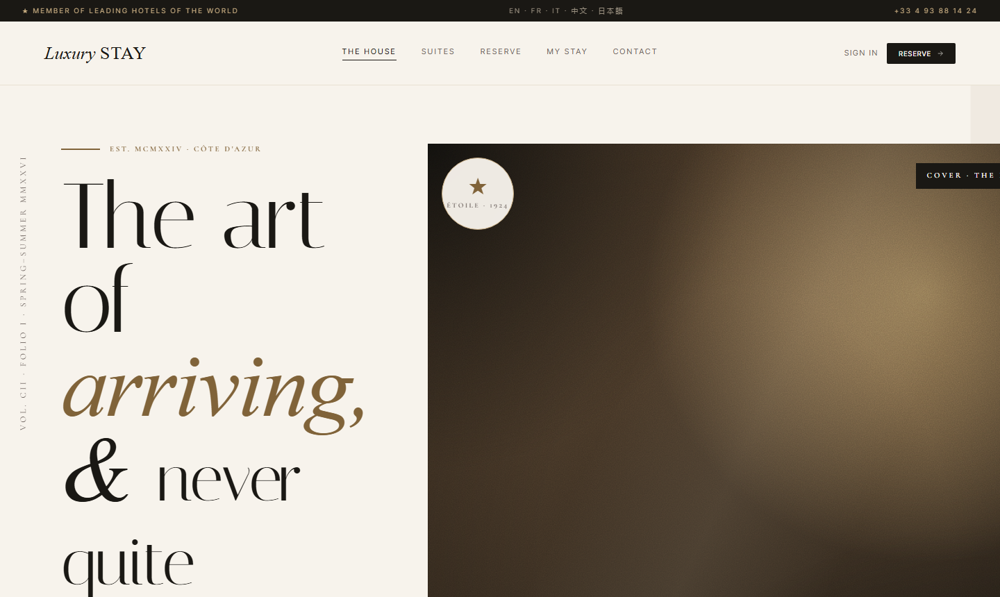
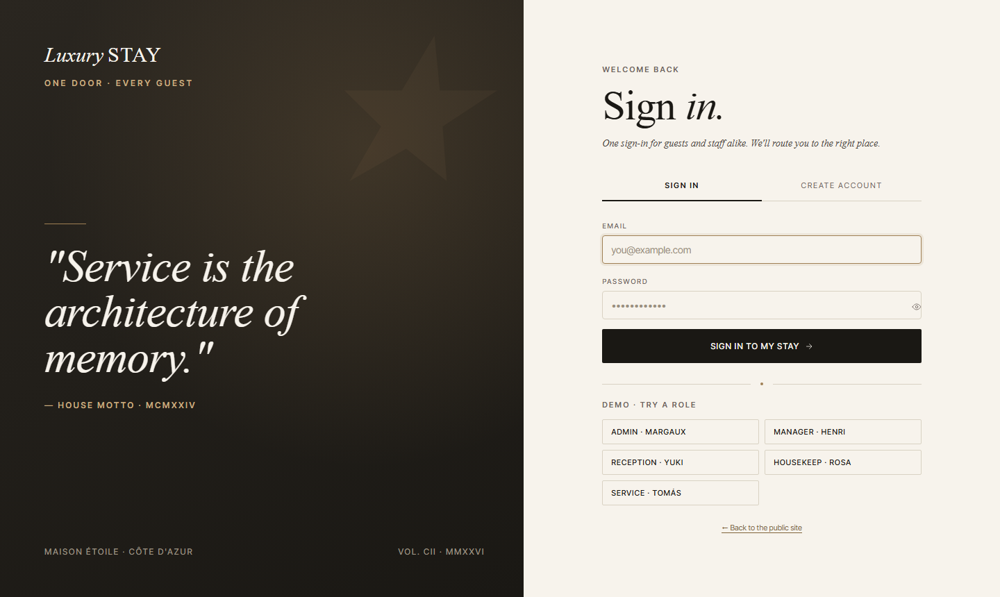
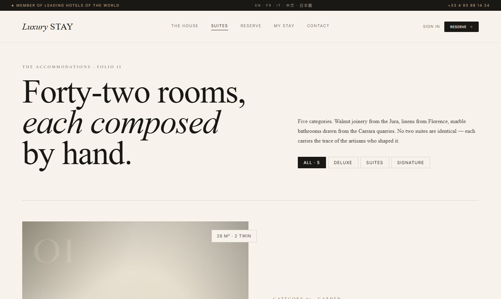

# LuxuryStay HMS

A full-stack hotel management system with a public booking site for guests and a role-based back-office for hotel staff.



## Features

**Guest-facing site**
- Browse suites, check availability and book online
- "My Stay" portal: view and cancel reservations, request services, report maintenance issues, leave feedback
- Contact form that feeds the staff inbox
- AI concierge chat (Google Gemini): answers suite questions, checks live availability and prepares a reservation. The guest finishes with a Confirm button, so the bot never books on its own

**Staff back-office**
- Dashboard with arrivals, departures and room status at a glance
- Reservations, check-in / check-out, room management and suite types
- Guest profiles with loyalty tiers and stay history
- Billing: invoices, line items and payments, exportable to PDF
- Housekeeping tasks, maintenance requests and guest service requests
- Feedback management and a contact inbox
- Analytics: revenue, occupancy, room performance and guest reports
- Staff management with configurable page access per role
- In-app notifications

| Dashboard | Reservations |
|---|---|
|  |  |

| Suites | Analytics |
|---|---|
|  |  |

## Tech stack

| Layer | Technologies |
|---|---|
| Frontend | React 18, Vite, React Router, TanStack Query, Axios, Recharts, jsPDF |
| Backend | Node.js, Express, Mongoose, JWT, bcrypt, express-validator, helmet, express-rate-limit |
| Database | MongoDB (local or Atlas) |
| Testing | Playwright (end-to-end) |

Roles: `admin`, `manager`, `receptionist`, `housekeeping`, `service` and `guest`, enforced by RBAC middleware on the API and by route protection in the UI.

## Getting started

Requirements: Node.js 18+ and a MongoDB instance.

```bash
git clone https://github.com/ShahneelSohail/Luxury-stay-HMS.git
cd Luxury-stay-HMS
```

**Backend**

```bash
cd luxurystay-backend
npm install
cp .env.example .env
```

Edit `.env` and set `MONGODB_URI`, a strong `JWT_SECRET`, and, to enable the AI concierge, a free `GEMINI_API_KEY` from [Google AI Studio](https://aistudio.google.com/apikey). Without a key the rest of the app works and the chat shows an unavailable message. Generate a JWT secret with:

```bash
node -e "console.log(require('crypto').randomBytes(64).toString('hex'))"
```

Seed demo users and rooms, then start the API on port 5000:

```bash
node seed.js
npm run dev
```

**Frontend**

```bash
cd luxurystay-frontend
npm install
npm run dev
```

The app runs at http://localhost:3000 and proxies `/api` to the backend.

## Demo accounts

`seed.js` creates one demo account per staff role (admin, manager, receptionist, housekeeping, service). Their emails and passwords are defined at the top of `luxurystay-backend/seed.js`, and the login page has quick-fill buttons for them. They are for local demos only: change or remove them before any real deployment.

## Tests

With both servers running and the database seeded:

```bash
cd luxurystay-frontend
npm run test:e2e
```

## Project structure

```
luxurystay-backend/    Express API (routes, controllers, models, validators, middleware)
luxurystay-frontend/   React app (pages, components, contexts, hooks) and Playwright specs
screenshots/           README images
```
